# SeedSigner on a $2 screen

**A text backend for [SeedSigner](https://seedsigner.com)**: the real SeedSigner app,
unmodified, running on character LCDs, tiny OLEDs and e-paper, on a Raspberry Pi Zero
or a bare ESP32. PSBTs move over a MicroSD card instead of a camera.

<table>
<tr>
<td width="58%">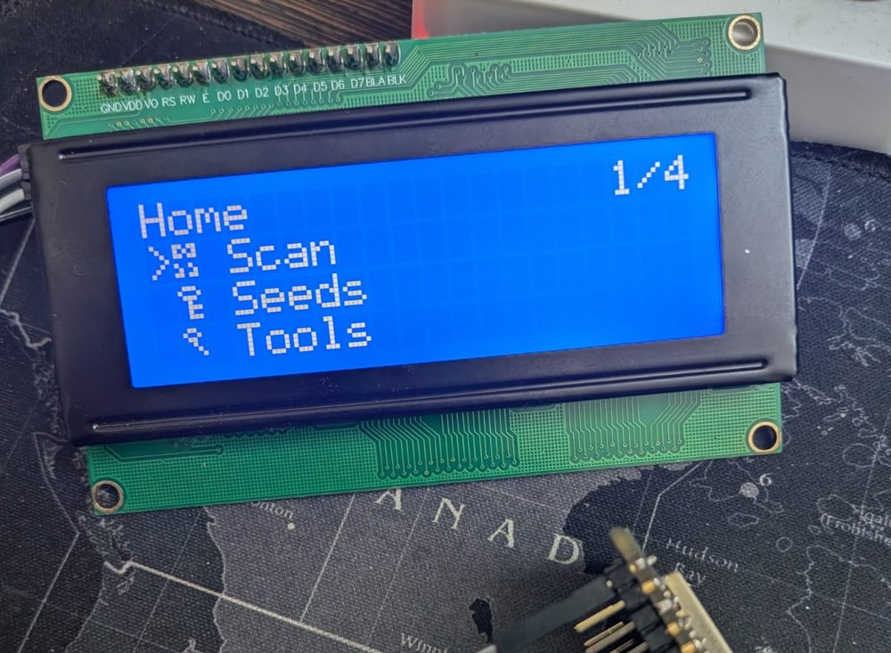</td>
<td width="42%">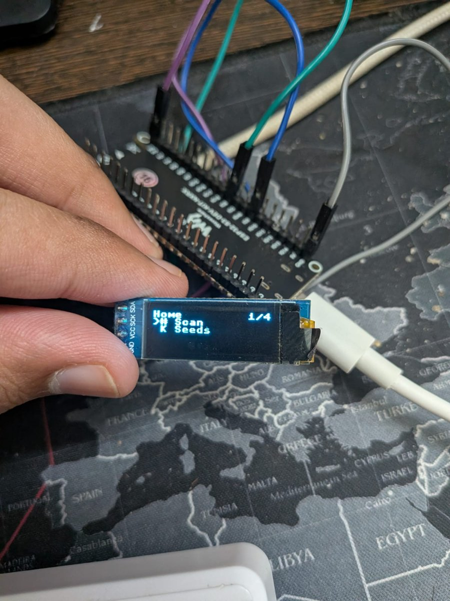</td>
</tr>
<tr>
<td align="center"><sub>20×4 character LCD, ESP32-S3</sub></td>
<td align="center"><sub>0.91″ 128×32 OLED, ESP32-S3</sub></td>
</tr>
</table>

A standard SeedSigner is a Pi Zero, a camera and a 240×240 colour screen, about $50.
This project asks how far down that cost can go and still sign Bitcoin transactions
safely. The current answer is a carrier board around a ~$6 ESP32-S2 with a ~$2 screen,
at about **$12 for the whole device**.

## How it works

SeedSigner's LVGL/MicroPython port describes every screen as data: a JSON payload of
what the screen *means* (a title, a list of buttons, a warning), not how to draw it.
That [screen contract](https://github.com/kdmukAI-bot/seedsigner/blob/integration/lvgl-mpy/docs/architecture/view-to-screen-json-contract.md)
was built so other backends could plug in. This repo is one.

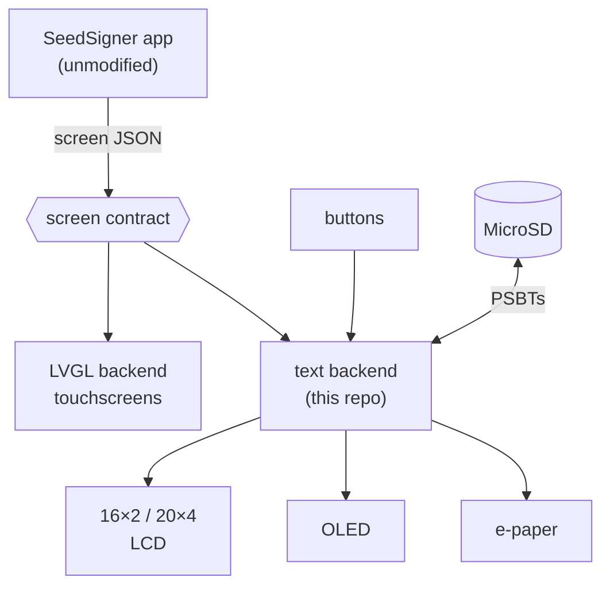

- **The bridge** ([`src/constrained_text_screens.py`](src/constrained_text_screens.py))
  stands in for the LVGL screen module. It turns each screen into text, reads the
  buttons, and returns the same results the graphical screens would. It never sees a
  private key.
- **The renderer** fits each screen to its grid: one item per page on 16×2, a
  scrolling window on 20×4, marquee scrolling for long labels, and SeedSigner's icons
  remapped into the LCD chip's 8 custom-glyph slots.
- **No camera.** Where SeedSigner would scan a QR code, the bridge lists PSBT files
  on the MicroSD card. Where it would show a QR code, it writes the signed PSBT back.
  Cards are mounted read-only to load a file, and written only to save one
  ([MicroSD workflow](docs/microsd_workflow_guide.md)).

## What the screens look like

The same SeedSigner screens, as the renderer lays them out for each display size
(drawn from the [golden snapshot tests](tests/golden/) by
[`tools/readme_lcd_images.py`](tools/readme_lcd_images.py)). Text that doesn't fit, like
"Review Transaction" on 16×2, scrolls on the device.

<table>
<tr><th>Screen</th><th>16×2 LCD</th><th>20×4 LCD</th></tr>
<tr><td>Main menu</td><td></td><td>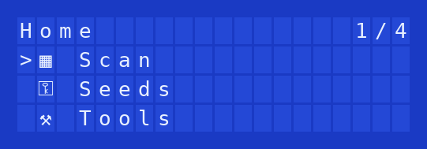</td></tr>
<tr><td>Seed words</td><td>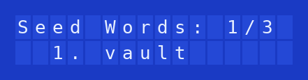</td><td>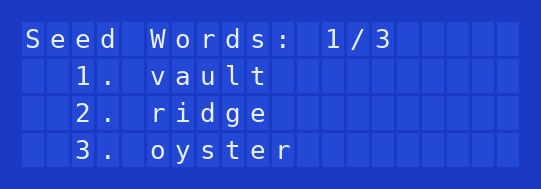</td></tr>
<tr><td>Transaction</td><td>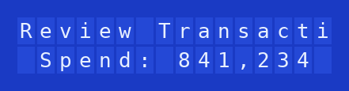</td><td>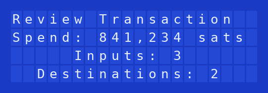</td></tr>
</table>

The full flow works this way: creating a seed, entering a passphrase, reviewing and
signing a transaction, and multisig.

## Hardware

| | Pi Zero (CPython) | ESP32 (MicroPython 1.27) |
|---|---|---|
| Status | Full SeedSigner flow, tested end to end on a Pi Zero v1.3 | App loads, derives seeds and signs on S3, S2 and C3. MicroSD support in progress. |
| Displays | 16×2 and 20×4 LCD, 128×32 and 128×64 OLED, 1.54″ e-paper | 16×2 and 20×4 LCD, 128×32 and 128×64 OLED |
| Input | 6 buttons (Waveshare HAT pinout) | 6–8 buttons, pins per chip ([pin map](docs/pin_map.md)) |
| Setup | [Flashable image](pi-image/README.md) or the [build guide](docs/constrained_build_guide.md) | [`firmware/build.sh`](firmware/build.sh) |

### How small a chip can run SeedSigner?

Measured on real boards, running the app, renderer, seed derivation and a 10-input
PSBT signed 10 of 10 ([details](research/silicon/README.md)):

| Chip (board) | Board price | Sign a 10-input PSBT | Seed from its words | PSRAM |
|---|---|---|---|---|
| ESP32-S3 (devkit) | ~$11 | 0.62 s | 0.14 s | 8 MB |
| **ESP32-S2 (S2 Mini)** | **~$6–7.50** | **0.82 s** | **0.14 s** | **2 MB** |
| ESP32-C3 (SuperMini) | ~$3 | 0.88 s | 0.72 s | none |

Even the ~$3 C3 signs in under a second. It's slower at seeds only because it has no
SHA-512 hardware. On the S2, cache size mattered more than clock speed: raising it from
8 KB to 16 KB cut signing from 2.8 s to 0.8 s.

<details>
<summary><b>Pi Zero wiring diagrams</b></summary>

<br>

**I2C OLED + buttons + MicroSD**
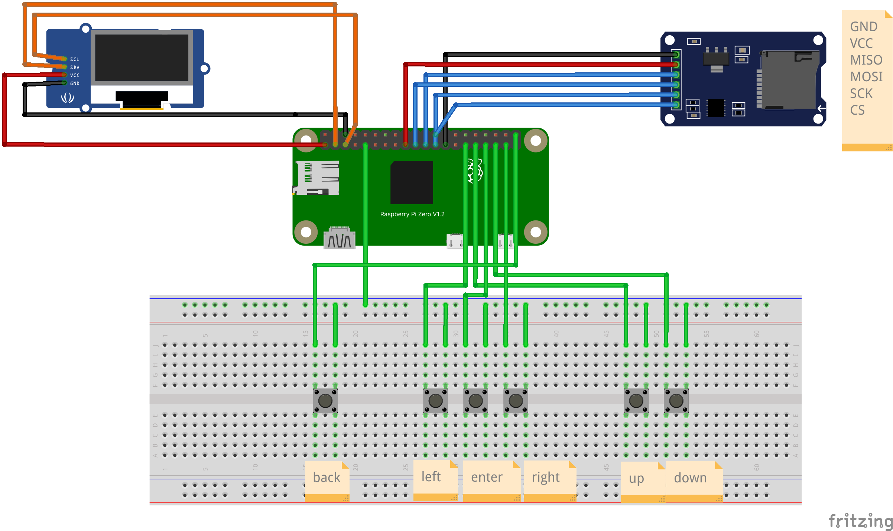

**I2C character LCD**
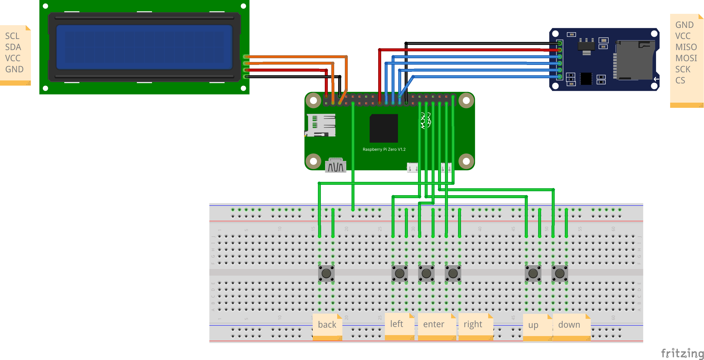

**SPI e-paper**
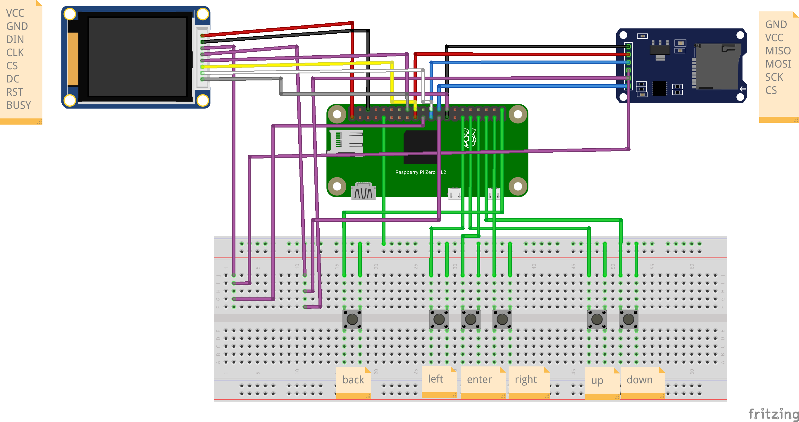

</details>

## Quick start

**Pi Zero, flashable image:** build the image (Docker, about 15 minutes), flash it, pick your display
in `seedsigner-config.json` on the boot partition, and boot. See
[`pi-image/`](pi-image/README.md).

**Pi Zero, by hand:**

```bash
git clone --recursive https://github.com/aphrodoe/seedsigner-constrained-ui-runner
cd seedsigner-constrained-ui-runner
./setup.sh                    # venv, the SeedSigner submodule, dependencies
source venv/bin/activate
python3 run_seedsigner.py     # the real app, on the display set in config.json
```

**ESP32:** `firmware/build.sh SEEDSIGNER_S2_MINI` builds MicroPython with native
secp256k1 and SHA-512 and the app frozen in. Boards: `SEEDSIGNER_S3_DEVKIT`,
`SEEDSIGNER_S2_MINI`, `SEEDSIGNER_C3_SUPERMINI`.

**No hardware:** the dual runner shows the LVGL screenshots next to live 16×2, 20×4,
16×8 and 25×16 text simulators (W/A/S/D to move, Space to select):

```bash
python3 tools/dual_runner.py
```

## The carrier board (in progress)

The next step is a circuit board anyone can build. The ESP32-S2 Mini, a display and a
MicroSD card plug into sockets. A 5-way joystick and three keys are soldered on, or
eight ordinary buttons if you'd rather avoid SMD.

- [Pin map](docs/pin_map.md): every GPIO, the header layout and the circuit.
- [Bill of materials](docs/bom.md): parts, Indian and international sources, about
  **₹1,170 (~$12) per device**.
- [Schematic](hardware/carrier/): a KiCad 10 project, with every connection listed in
  [`connections.md`](hardware/carrier/connections.md) and a script that checks the
  schematic against it. Layout: next.

Later: an all-in-one board, a 3D-printed case, and audio-only navigation for blind
users.

## Documentation

| | |
|---|---|
| [Build guide](docs/constrained_build_guide.md) | Wiring, software setup and `config.json` for the Pi Zero and ESP32 |
| [MicroSD workflow](docs/microsd_workflow_guide.md) | How PSBTs move on and off the card, and why it's read-only by default |
| [Text UI design guide](docs/text_ui_design_guide.md) | Display tiers, pagination, sliding windows, icon mapping |
| [Pin map](docs/pin_map.md) · [BOM](docs/bom.md) | The carrier board |
| [Screen survey](research/screens/README.md) | Displays compared on cost, lifetime, availability and reliability |
| [Silicon profiling](research/silicon/README.md) | The chip measurements above, with raw logs |
| [Pi Zero image](pi-image/README.md) | Building and flashing the image |

## Tests

```bash
python3 -m pytest tests/                           # 922 tests, a few seconds
python3 -m pytest tests/ --update-golden           # after an intentional layout change
```

632 golden snapshots pin the rendering of every SeedSigner screen at every grid size.
The rest test the bridge against the screen contract, the MicroSD handling, the input
pin maps and the drivers. CI runs them on every pull request and on every push to main.

## Status and credits

- **Not for real funds yet.** The upstream app comes from the `integration/lvgl-mpy`
  branch of the LVGL/MicroPython port, which hasn't been merged into SeedSigner's
  releases. Production SeedSigner is still the Pi Zero/PIL build.
- Built on [SeedSigner](https://github.com/SeedSigner/seedsigner) and its
  LVGL/MicroPython port by Keith Mukai, SeedSigner's lead developer, who mentors this
  work.
- Started during **Summer of Bitcoin 2026**. Continued under a **Bitshala Developer
  Fellowship** (Oct 2026 – Mar 2027).

## License

[MIT](LICENSE), the same as SeedSigner.
